<p align="center">
  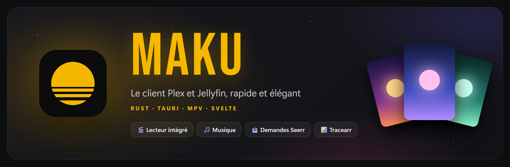
</p>

<h3 align="center">Vos films, vos séries et votre musique Plex, dans une application de bureau rapide et soignée.</h3>

<p align="center">
  
  
  
  
  
  
  
  
  <a href="LICENSE"></a>
</p>

<p align="center">
  <a href="#-ce-que-fait-plexr">Fonctionnalités</a> ·
  <a href="#-aperçu">Aperçu</a> ·
  <a href="#-installer">Installer</a> ·
  <a href="#%EF%B8%8F-configurer">Configurer</a> ·
  <a href="#-développer">Développer</a> ·
  <a href="#-confidentialité">Confidentialité</a> ·
  <a href="#%EF%B8%8F-mentions-légales">Mentions légales</a> ·
  <a href="#-licence">Licence</a>
</p>

---

Plexr est un client [Plex](https://www.plex.tv) pour PC, écrit en Rust avec [Tauri](https://tauri.app). La vidéo
et la musique sont lues par [mpv](https://mpv.io), directement dans la fenêtre de l'application, et l'interface est
pensée comme celle d'une box TV : grands visuels, bandeaux qui défilent, rien de superflu.

Il existe aussi en **application Android**, pour les **téléphones**, les **tablettes** et **Android TV / Google TV** :
une interface tactile façon application mobile sur téléphone, et une interface dédiée à la télécommande, plus
légère, pour rester fluide sur le matériel limité des téléviseurs.

Il réunit aussi deux outils que l'on utilise souvent à côté de Plex : **Seerr** (Jellyseerr / Overseerr), pour
demander un film ou une série absent de la bibliothèque, et **Tracearr**, pour suivre ses statistiques de
visionnage. Tout se fait avec son compte Plex : aucune clé, aucun mot de passe supplémentaire.

## ✨ Ce que fait Plexr

<table>
  <tr>
    <td width="50%" valign="top">
      <h4>🎬 Il lit tout, dans sa propre fenêtre</h4>
      Vidéo intégrée avec une barre de contrôle maison : progression, ±10 s, épisode précédent et suivant,
      volume, pistes audio et sous-titres, plein écran, raccourcis clavier. Reprise là où vous vous étiez arrêté.
    </td>
    <td width="50%" valign="top">
      <h4>🏠 Il met vos bibliothèques en valeur</h4>
      Accueil et bibliothèques avec un bandeau qui fait défiler cinq titres, puis un « Continuer à regarder »
      façon plateforme de streaming : grandes affiches, et celle survolée s'ouvre en grand avec sa scène, son
      épisode, sa progression et le bouton Reprendre ; un clic sur la carte ouvre la fiche. Puis de grands panneaux « À la une » et les rangées de Plex.
      La fiche d'un film ou d'une série plonge dans son ambiance, comme Jellyfin : son fond en haute définition
      sur toute la largeur (celui de la saison pour une série), le logo en grand et centré avec le titre
      d'origine, la note et l'heure de fin, le résumé dessous, puis deux panneaux — l'équipe d'un côté, la
      vidéo, l'audio et les sous-titres de l'autre — la distribution et « Plus de ce genre ».
      Les titres s'affichent avec leur logo officiel, comme dans Jellyfin : celui du serveur, sinon celui du
      service en ligne de Plex — un logo dans la langue de l'interface passe avant celui du serveur, souvent en anglais —, et en dernier recours de TMDB avec votre clé d'API gratuite (Réglages → Seerr et Tracearr) ; les épisodes et les saisons reprennent celui de leur série ; sans logo nulle part, une typographie de cinéma choisie selon le genre.
    </td>
  </tr>
  <tr>
    <td valign="top">
      <h4>🗂️ Il range par catégories</h4>
      Chaque genre devient une grande carte colorée avec un éventail des affiches les mieux notées. Un clic
      filtre la bibliothèque.
      Les bibliothèques de films ont aussi leurs **collections** (sagas, univers…) : chacune ouvre sa page, avec
      ses films dans l'ordre de sortie et un bouton qui lance le premier pas encore vu.
    </td>
    <td valign="top">
      <h4>🎵 Il joue votre musique</h4>
      Une page d'accueil façon Apple Music : grands panneaux des derniers albums, listes de lecture,
      « Titres du moment », pochettes qui grandissent avec la fenêtre. File d'attente, lecture aléatoire et
      vue « En cours de lecture ». Une barre de lecture flottante, en verre dépoli teinté par la pochette, reste
      en bas pendant que vous naviguez.
    </td>
  </tr>
  <tr>
    <td valign="top">
      <h4>📥 Il fait vos demandes</h4>
      Découvrez les tendances et les sorties à venir via Seerr, lisez la fiche complète (notes, casting,
      bande-annonce) et demandez un film ou des saisons en un clic.
    </td>
    <td valign="top">
      <h4>📊 Il raconte vos habitudes</h4>
      Avec Tracearr : temps passé devant l'écran, top 10 du mois, plus long marathon, genres préférés… dans
      une page façon Apple TV.
    </td>
  </tr>
  <tr>
    <td valign="top">
      <h4>🔍 Il trouve tout</h4>
      Une seule recherche pour les films, séries et artistes de la bibliothèque, puis les titres absents
      que l'on peut demander. Un acteur, sur une fiche, ouvre tous ses films et séries du serveur.
    </td>
    <td valign="top">
      <h4>🔑 Il se connecte avec Plex</h4>
      Connexion par code PIN, choix du serveur avec test automatique des adresses ; Seerr et Tracearr
      utilisent le même compte.
    </td>
  </tr>
  <tr>
    <td valign="top">
      <h4>✏️ Il modifie vos fiches</h4>
      Titre, résumé, dates, genres, affiche et fond d'écran d'un film, d'une série ou d'un album, avec les
      verrous de champ de Plex. Menu ⋮ (ou clic droit) sur chaque jaquette.
    </td>
    <td valign="top">
      <h4>🛠️ Il administre le serveur</h4>
      Lectures en cours, entretien des bibliothèques et réglages du serveur (général, réseau, transcodeur…),
      pour l'administrateur uniquement.
    </td>
  </tr>
  <tr>
    <td valign="top">
      <h4>🎨 Il prend vos couleurs</h4>
      Quatre couleurs au choix (jaune, rouge, vert, violet) dans Réglages → Interface ; l'icône de l'application
      suit, dans la barre des tâches comme sur l'écran d'accueil d'Android et de la TV.
    </td>
    <td valign="top">
      <h4>🌍 Il parle votre langue</h4>
      Français, anglais, espagnol, allemand et néerlandais : Plexr suit la langue du système, ou celle choisie dans
      Réglages → Interface. Les fiches Seerr et les rangées de Plex arrivent dans la même langue.
    </td>
  </tr>
  <tr>
    <td valign="top">
      <h4>🔄 Il se met à jour tout seul</h4>
      Au lancement, une fenêtre présente la nouvelle version, ses nouveautés et ses corrections (dans la langue
      de l'interface ; Réglages → Compte les rappelle pour la version installée) ; un clic télécharge et installe
      le bon paquet, y compris sur Android TV, où installer à la main est fastidieux.
    </td>
    <td valign="top">
      <h4>📨 Il s'invite en un QR code</h4>
      L'administrateur partage un QR code ; chez l'utilisateur, il remplit Seerr et Tracearr et lance la
      connexion. Sur la télé, on le montre simplement à son téléphone.
    </td>
  </tr>
  <tr>
    <td valign="top">
      <h4>📺 Il passe sur la télé</h4>
      Sur Android TV, une interface faite pour la télécommande, à la manière des applications TV : la fiche de
      l'élément sélectionné en haut, des rangées de jaquettes en dessous, un menu qui se déplie quand on y entre.
      Connexion par un code à saisir sur plex.tv/link depuis son téléphone.
    </td>
    <td valign="top">
      <h4>📱 Il tient dans la main</h4>
      Sur téléphone, une interface mobile : onglets en bas, bandeau et « Continuer à regarder » à la taille de
      l'écran, mini-lecteur façon Spotify et musique pilotable depuis la notification, même Plexr fermé.
      En voiture, la bibliothèque musicale se parcourt et se lit depuis l'écran d'Android Auto.
      Sur tablette, l'interface de l'ordinateur adaptée au toucher.
    </td>
  </tr>
</table>

## 📸 Aperçu

> [!NOTE]
> Ces captures viennent du **mode démo** de Plexr : la bibliothèque est fictive et toutes les affiches sont
> générées par le programme. Aucun film, aucune série ni aucune œuvre réelle n'y figure.

<p align="center">
  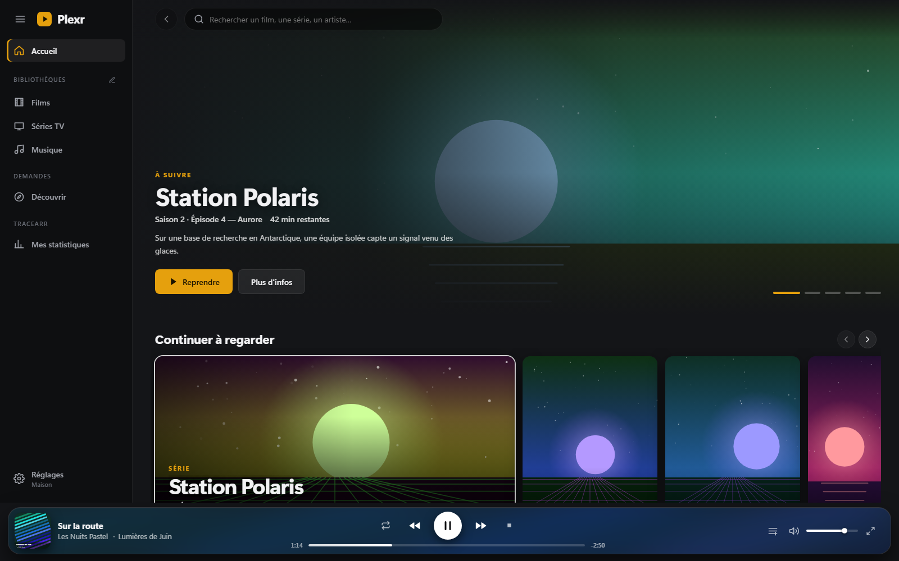
  <br /><em>L'accueil : bandeau « À suivre », rangées et barre de musique.</em>
</p>

<table>
  <tr>
    <td width="50%">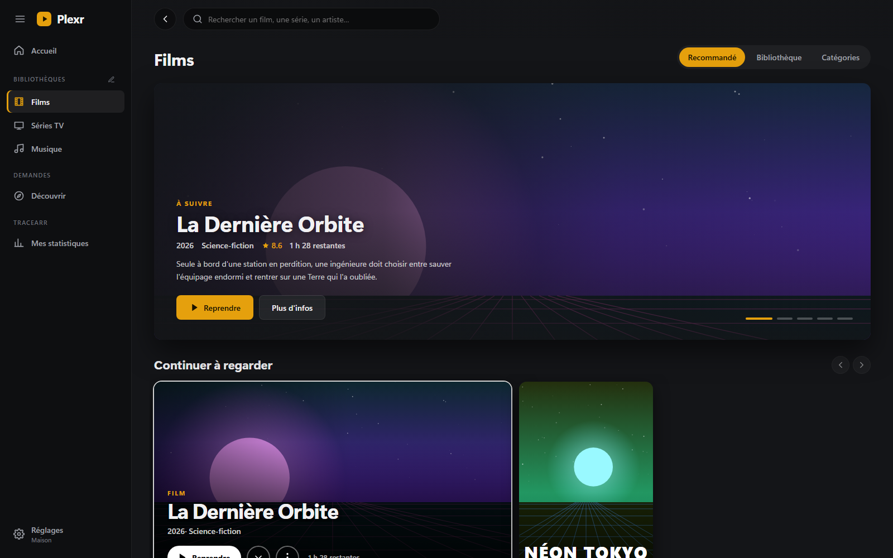<br /><em>🎞️ Une bibliothèque, onglet Recommandé</em></td>
    <td width="50%">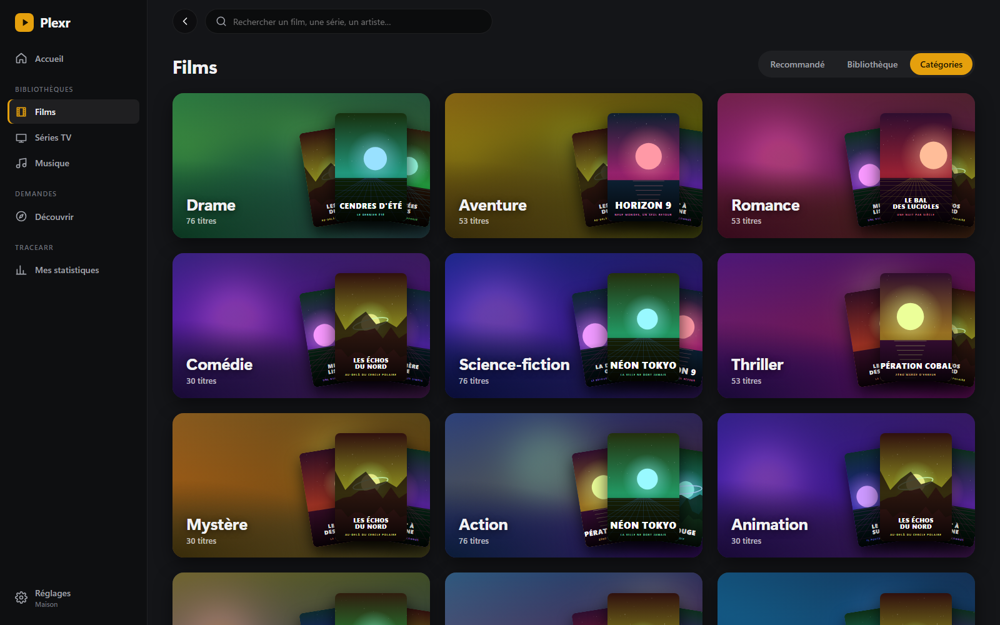<br /><em>🗂️ Les catégories</em></td>
  </tr>
  <tr>
    <td>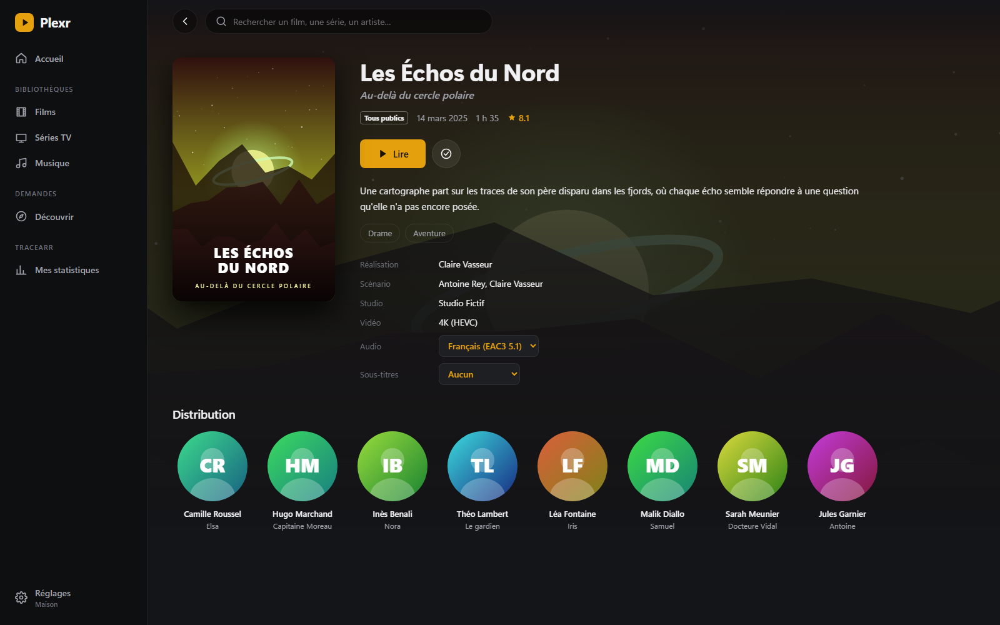<br /><em>📄 La fiche d'un film</em></td>
    <td>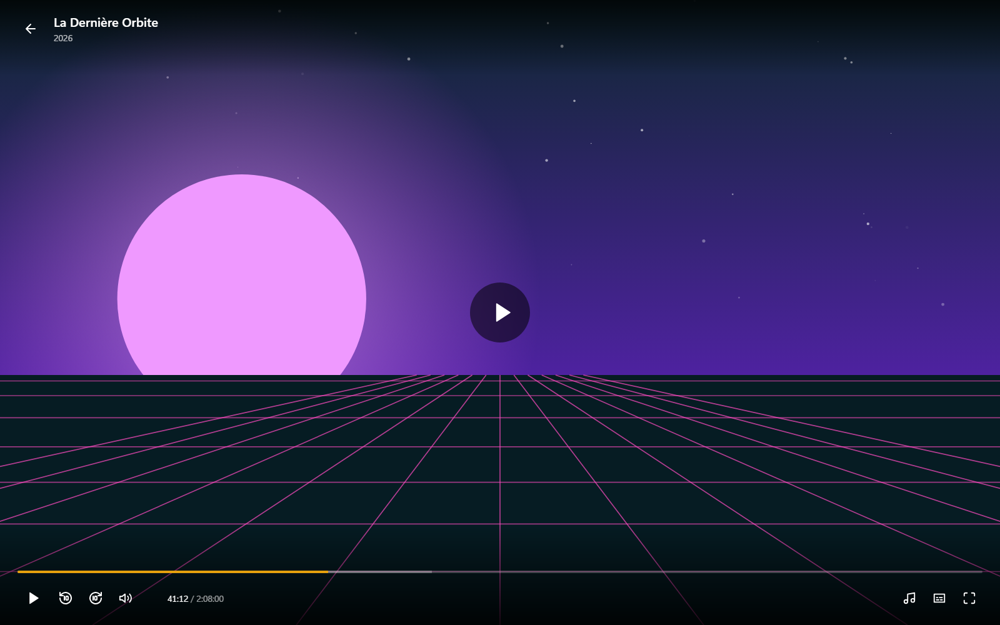<br /><em>▶️ Le lecteur intégré</em></td>
  </tr>
  <tr>
    <td>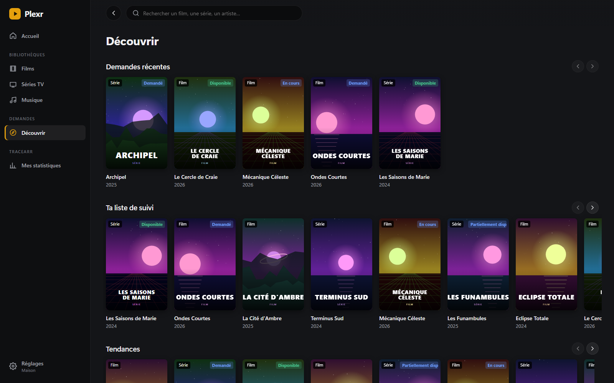<br /><em>🧭 Découvrir avec Seerr</em></td>
    <td>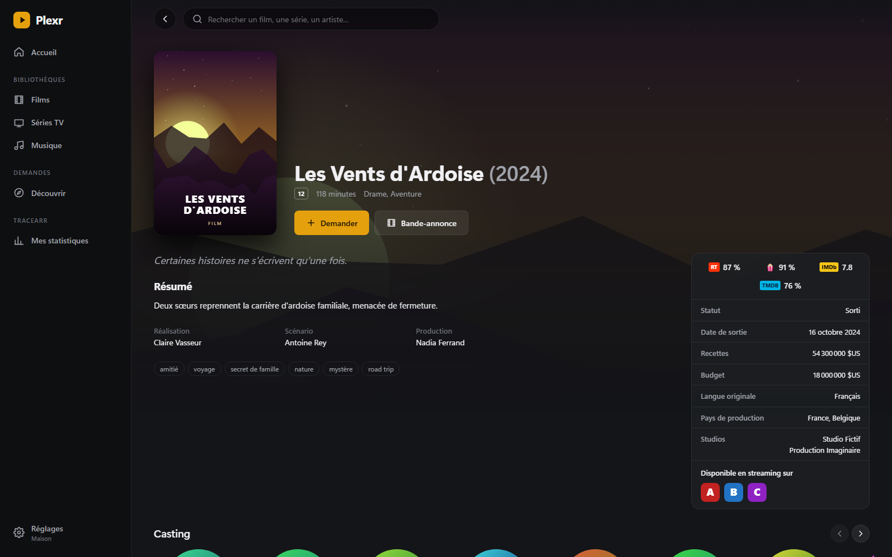<br /><em>📥 Demander un titre</em></td>
  </tr>
  <tr>
    <td>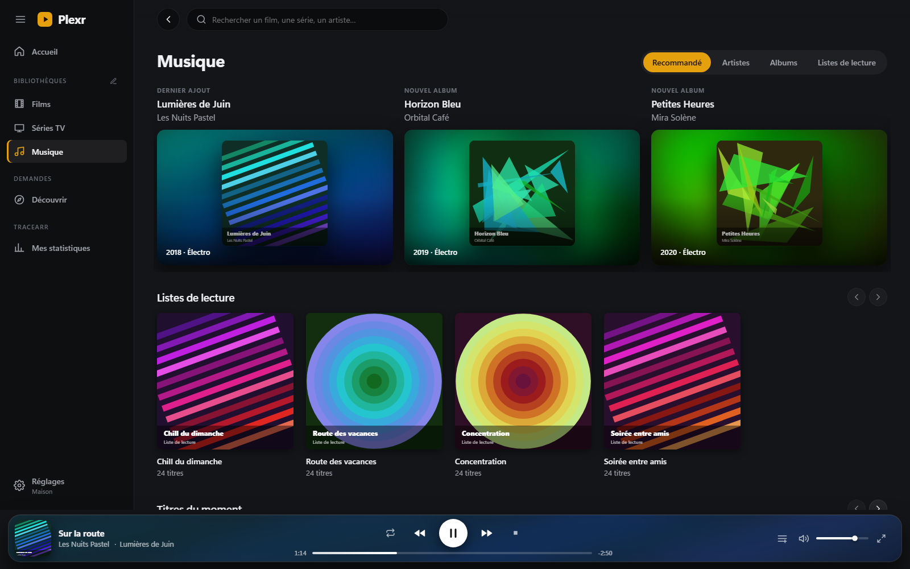<br /><em>🎵 La musique</em></td>
    <td>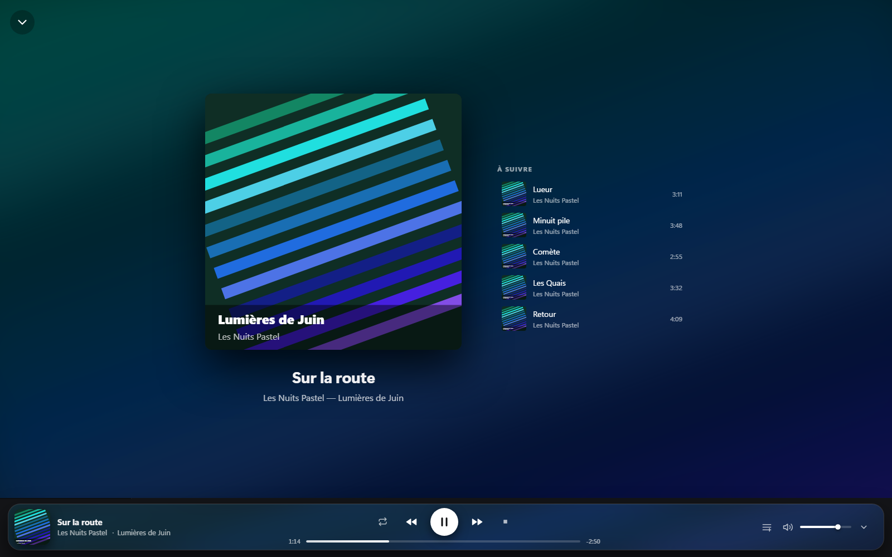<br /><em>🎧 En cours de lecture</em></td>
  </tr>
  <tr>
    <td>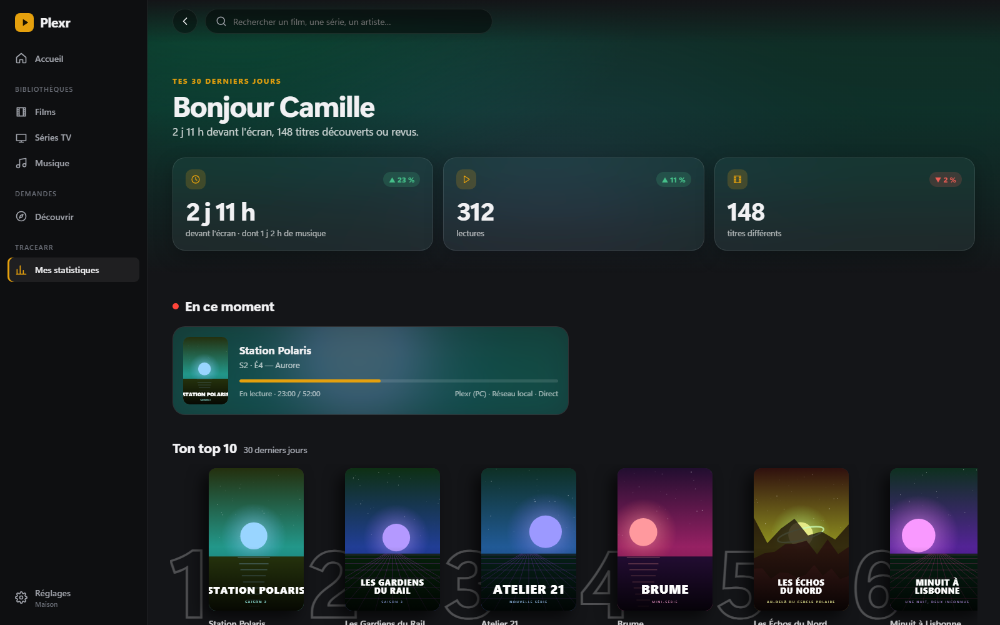<br /><em>📊 Mes statistiques (Tracearr)</em></td>
    <td>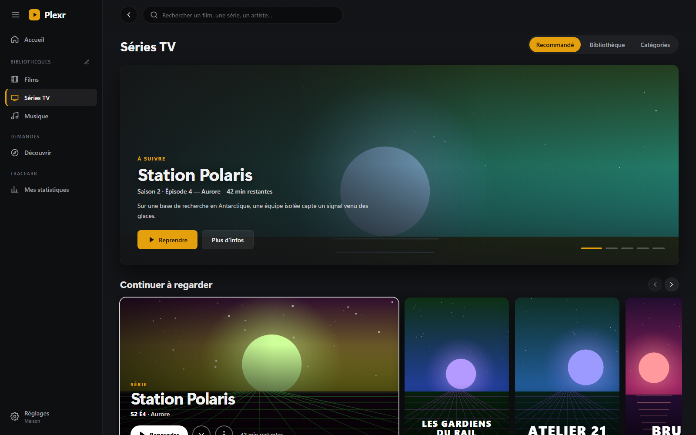<br /><em>📺 Les séries</em></td>
  </tr>
</table>

## 🧰 Ce qu'il faut

<table>
  <tr><td>💻 <b>Système</b></td><td>Windows 10 ou 11, Linux (Fedora, Debian, Ubuntu… en 64 bits), macOS 11 et plus, ou Android 7 et plus (téléphones, tablettes, Android TV, Google TV ; processeurs ARM)</td></tr>
  <tr><td>🎞️ <b>Plex</b></td><td>un compte Plex et l'accès à un serveur Plex Media Server</td></tr>
  <tr><td>▶️ <b>mpv</b></td><td>sur ordinateur, le lecteur <a href="https://mpv.io">mpv</a> : fourni avec l'installeur Windows, installé automatiquement avec les paquets RPM et DEB, sinon voir ci-dessous (inutile sur Android)</td></tr>
  <tr><td>➕ <b>En option</b></td><td>une instance <a href="https://github.com/seerr-team/seerr">Seerr / Jellyseerr / Overseerr</a> pour les demandes, une instance <a href="https://github.com/connorgallopo/Tracearr">Tracearr</a> pour les statistiques</td></tr>
</table>

## 🚀 Installer

Les paquets de chaque version sont publiés dans les [Releases](../../releases) du dépôt.

| Système | Fichier | Installation |
| --- | --- | --- |
| 🪟 **Windows** | `Plexr_<version>_x64-setup.exe` (ou `.msi`) | lancez l'installeur : mpv est inclus, rien d'autre à installer |
| 🎩 **Fedora / RHEL** | `Plexr-<version>-1.x86_64.rpm` | `sudo dnf install ./Plexr-*.rpm` (installe aussi mpv) |
| 🐧 **Debian / Ubuntu** | `Plexr_<version>_amd64.deb` | `sudo apt install ./Plexr_*.deb` (installe aussi mpv) |
| 📦 **Autres Linux** | `Plexr_<version>_amd64.AppImage` | rendez-le exécutable (`chmod +x`), installez mpv avec votre gestionnaire de paquets |
| 🍎 **macOS** | `Plexr_<version>_universal.dmg` | glissez Plexr dans Applications, puis `brew install mpv` |
| 🤖 **Android (téléphone, tablette, TV)** | `Plexr_<version>_android.apk` | voir ci-dessous |

Plexr s'ouvre ensuite comme n'importe quel logiciel (menu Démarrer, lanceur d'applications ou Launchpad).

> [!NOTE]
> **Sous Linux et macOS**, la vidéo s'ouvre dans une fenêtre mpv séparée, en plein écran : Plexr la pilote à
> distance (pause, avance, pistes…) et suit la progression comme sous Windows. L'incrustation de la vidéo dans la
> fenêtre de Plexr n'existe pour l'instant que sous Windows. La musique fonctionne partout de la même façon.

> [!IMPORTANT]
> **macOS** : l'application n'est pas signée par Apple. Au premier lancement, faites un clic droit sur Plexr →
> **Ouvrir**, puis confirmez.

### 📱 Android : téléphones, tablettes et TV

L'APK n'est pas sur le Play Store : il s'installe à la main (« sideload »), une seule fois — les versions
suivantes s'installent depuis Plexr (voir *Mises à jour*).

- **Téléphone et tablette** : copiez l'APK sur l'appareil et ouvrez-le ; Android demande d'autoriser
  l'installation depuis le gestionnaire de fichiers ou le navigateur.
- **Téléviseur** : le plus simple est l'application *Downloader* (ou un gestionnaire de fichiers avec une clé
  USB). Depuis un ordinateur, avec le débogage activé dans les options pour les développeurs de la TV :
  `adb connect <ip-de-la-tv>:5555` puis `adb install Plexr_<version>_android.apk`.

Plexr apparaît ensuite parmi les applications, avec sa bannière sur l'écran d'accueil de la TV.

Sous **Android 17**, Plexr demande au premier lancement l'autorisation d'accéder aux appareils du réseau local :
sans elle, un serveur sur le réseau de la maison (Jellyfin, ou Plex par son adresse locale) reste injoignable.

**Sur téléphone**, l'interface prend la forme d'une application mobile : un en-tête compact sous la barre
d'état, des onglets en bas (Accueil, Bibliothèques, Découvrir, Stats, Réglages), le bandeau et « Continuer à
regarder » à la taille de l'écran, des fiches qui s'empilent. Un appui long sur une affiche ouvre son menu ; dans
les bandes d'onglets, l'onglet touché se centre. Les vidéos passent en paysage et en plein écran.

**Musique en arrière-plan** : sur téléphone comme sur tablette, la musique continue quand Plexr est quitté, avec
une notification (pochette, titre, précédent / lecture / suivant, progression) qui la pilote aussi depuis l'écran
de verrouillage et les boutons d'un casque Bluetooth. Fermer Plexr depuis les applications récentes l'arrête.
Le mini-lecteur, façon Spotify, ouvre en plein écran la pochette, la progression et toutes les commandes.

**Android Auto** : Plexr apparaît parmi les applications de musique de la voiture, avec quatre onglets —
**Accueil** (ajouts récents), **Artistes** (avec une lecture aléatoire de toute la bibliothèque), **Albums** et
**Playlists** — illustrés de leurs pochettes. Un album ou une playlist se lit d'un coup ou à partir d'un morceau,
avec la file d'attente à l'écran ; « Joue … sur Plexr » lance un artiste, un album ou un morceau à la voix. La
voiture lit elle-même la musique (ExoPlayer), même si Plexr n'est pas ouvert sur le téléphone : le compte et le
serveur viennent de la configuration de Plexr, et hors du Wi-Fi l'adresse distante du serveur (ou le relais Plex)
prend le relais. Les écoutes remontent dans l'historique de Plex. Une musique lancée sur le téléphone remplace
celle de la voiture, et inversement.

> [!NOTE]
> **Lecture sur Android** : il n'y a pas de mpv. La vidéo est lue par ExoPlayer, le lecteur natif qu'utilisent
> aussi Plex et Wholphin : le fichier d'origine (4K, HEVC, HDR compris) est décodé par l'appareil et affiché dans
> sa propre couche, sous l'interface de lecture de Plexr — fluide même sur un téléviseur modeste, au bon format
> (bandes noires pour un film plus large que l'écran). Les pistes audio
> et les sous-titres (intégrés ou externes) se choisissent pendant la lecture. Si l'appareil ne sait pas lire un
> format, le serveur Plex le convertit à la volée (HLS, 1080p). La musique est lue directement. La reprise,
> l'épisode suivant et la progression fonctionnent comme sur ordinateur.

> [!TIP]
> **Sur téléviseur**, l'interface est volontairement plus sobre que sur ordinateur (pas de carrousel animé, de
> cartes qui s'agrandissent ni de flou) pour consommer peu de mémoire. Les nouveautés arrivent d'abord sur
> l'application de bureau. Un élément est toujours sélectionné (à l'arrivée, après une lecture), et les fiches
> se parcourent rangée par rangée comme dans Plex et Wholphin : haut / bas d'une rangée à l'autre (boutons,
> audio, sous-titres, distribution, « Plus de ce genre »), gauche / droite dans la rangée. Comme dans Plex, un **appui long sur OK** (ou la touche Menu) sur une jaquette ouvre
> le menu du titre : reprendre ou recommencer, liste de visionnage, note, retrait de « Continuer à regarder »,
> vu / non vu, et pour la musique lecture aléatoire, aller à l'artiste ou à l'album.

### 🔄 Mises à jour

À chaque lancement, Plexr consulte la dernière version publiée dans les [Releases](../../releases). S'il y en a
une plus récente, une fenêtre en présente les nouveautés par-dessus l'application floutée ; **Mettre à jour**
télécharge le paquet qui convient et l'installe :

| Système | Ce qui se passe |
| --- | --- |
| 🪟 Windows | l'installeur tourne avec une simple barre de progression, puis Plexr redémarre |
| 🤖 Android / TV | l'installateur d'Android s'ouvre ; la première fois, Android demande d'autoriser Plexr à installer des applications |
| 📦 Linux (AppImage) | le fichier est remplacé et Plexr redémarre |
| 🎩 Linux (RPM / DEB) | le paquet s'ouvre dans la logithèque du système |
| 🍎 macOS | l'image disque s'ouvre ; glissez Plexr dans Applications |

**Plus tard** referme la fenêtre jusqu'au prochain lancement. **Réglages → Compte → Rechercher les mises à jour**
lance la même vérification à la demande. Rien n'est envoyé : Plexr lit seulement la page publique des versions
sur GitHub.

### Pourquoi pas encore de Flatpak ?

Flatpak est le meilleur format pour toucher toutes les distributions via Flathub, mais il demande d'embarquer mpv
dans le bac à sable et Flathub n'accepte que les projets publics. Il viendra avec l'ouverture du dépôt ; d'ici là,
le RPM est la solution la plus simple sous Fedora (mises à jour par `dnf`, mpv venant des dépôts officiels).

### Compiler soi-même

Il faut [Rust](https://rustup.rs) et [Node.js](https://nodejs.org), plus :

- **Windows** : les [Visual Studio Build Tools](https://visualstudio.microsoft.com/fr/visual-cpp-build-tools/)
  (charge de travail « Développement Desktop en C++ ») ;
- **Fedora** : `sudo dnf install webkit2gtk4.1-devel openssl-devel librsvg2-devel` et le groupe
  `sudo dnf group install c-development` ;
- **Debian / Ubuntu** : `sudo apt install libwebkit2gtk-4.1-dev build-essential librsvg2-dev libssl-dev` ;
- **macOS** : les outils en ligne de commande Xcode (`xcode-select --install`).

```bash
git clone https://github.com/yanutros/plexr.git
cd plexr
npm install
npm run tauri build
```

Les paquets sont créés dans `src-tauri/target/release/bundle/` (sous-dossiers `nsis`, `msi`, `rpm`, `deb`,
`appimage` ou `dmg` selon le système).

Sous Windows, `scripts/fetch-mpv.mjs` télécharge d'abord une version épinglée de mpv
([mpv-winbuild-cmake](https://github.com/shinchiro/mpv-winbuild-cmake)), vérifiée par son empreinte SHA-256,
dans `src-tauri/mpv-win/` (ignoré par git) : l'installeur la dépose dans `Plexr\mpv\`, où Plexr la trouve. Un
chemin de mpv indiqué dans **Réglages → Lecteur** reste prioritaire.

**Android.** Il faut en plus le JDK 17, le SDK Android (plateforme 36, build-tools, platform-tools) et le NDK,
avec les variables `JAVA_HOME`, `ANDROID_HOME` et `NDK_HOME`, ainsi que les cibles Rust
(`rustup target add aarch64-linux-android armv7-linux-androideabi`). Sous Windows, le **mode développeur** doit
être activé (Tauri crée des liens symboliques). Le projet Android est versionné dans `src-tauri/gen/android`.

```bash
npx tauri android build --apk --target aarch64 --target armv7
```

L'APK universel est créé dans `src-tauri/gen/android/app/build/outputs/apk/universal/release/`. Pour le signer,
placez un fichier `src-tauri/gen/android/keystore.properties` (ignoré par git) contenant `storeFile`,
`password` et `keyAlias` ; sans lui, l'APK n'est pas signé et Android refuse de l'installer.

### Publier une version

Le workflow [`.github/workflows/paquets.yml`](.github/workflows/paquets.yml) construit les paquets des trois
systèmes sur GitHub Actions et les joint à une version en brouillon. Il se lance en poussant une étiquette
(`git tag v0.2.0 && git push origin v0.2.0`, après avoir mis à jour la version dans `package.json`,
`src-tauri/Cargo.toml` et `src-tauri/tauri.conf.json`) ou à la main depuis l'onglet **Actions**.

L'APK Android est compilé et signé sur l'ordinateur du mainteneur (la clé de signature ne quitte pas sa
machine), puis ajouté à la version avec `gh release upload`.

## ▶️ Premiers pas

1. Choisissez votre serveur de médias, **Plex** ou **Jellyfin**. Avec Plex, cliquez sur **Se connecter avec
   Plex** : votre navigateur s'ouvre, validez le code. Avec Jellyfin, saisissez l'adresse du serveur, votre
   identifiant et votre mot de passe, ou utilisez **Quick Connect** (un code à valider depuis une autre application
   Jellyfin déjà connectée, pratique sur téléviseur) : accueil, bibliothèques (mixtes comprises), fiches, séries,
   pages d'acteurs, recherche, lecture (fichier d'origine ou flux converti), progression, « J'aime », « Retirer de
   Continuer à regarder » et musique fonctionnent comme avec Plex ; la carte Compte des Réglages montre le nom,
   la photo de profil et le rôle du compte Jellyfin. Seerr se connecte avec le compte Jellyfin ;
   Tracearr garde sa connexion par compte plex.tv.
   L'écran de choix montre les deux services avec leur icône. Plexr retient ensuite les serveurs utilisés
   (**Réglages → Compte → Serveurs de médias** : Plex, Jellyfin ou les deux) : avec un seul, il ne repose plus la
   question. Avec les deux, **Changer de serveur** ramène au choix sans perdre les connexions : le compte Plex reste
   connecté, et la dernière connexion Jellyfin est gardée 30 jours sans utilisation (vérifiée auprès du serveur à
   chaque retour ; le mot de passe n'est jamais enregistré). **Se déconnecter** efface tout et ferme aussi les
   sessions Jellyfin sur le serveur.
2. Choisissez votre serveur, présenté comme un profil avec la photo du compte Plex de son propriétaire : Plexr
   teste ses adresses et garde la plus rapide (locale, distante, puis relais), et la revérifie à chaque lancement.
   Si le routeur ou le DNS bloque les adresses locales `*.plex.direct` (protection contre le « DNS rebinding »),
   Plexr utilise directement l'adresse IP locale du serveur (`http://10.0.0.2:32400`), comme Plex Web, plutôt
   que de faire le tour par l'adresse publique.
3. Parcourez vos bibliothèques et lancez une lecture.
4. Dans **Réglages → Seerr et Tracearr**, ajoutez si vous le souhaitez Seerr et Tracearr, à la main ou avec
   l'invitation de l'administrateur (voir ci-dessous).

**Sur téléviseur**, il n'y a pas de navigateur : Plexr affiche un code à quatre caractères. Allez sur
[plex.tv/link](https://plex.tv/link) depuis un téléphone ou un ordinateur et saisissez-le ; la connexion se fait
toute seule. Ce mode est aussi proposé sur ordinateur et tablette (**Avec un code**).

### 📺 À la télécommande

Les flèches déplacent la sélection (entourée en doré), **OK** ouvre ou lance, **Retour** ferme ce qui est ouvert
puis revient à la page précédente. Sur « Continuer à regarder », OK reprend directement la lecture. Pendant une
vidéo, les touches lecture / pause et suivant / précédent de la télécommande fonctionnent. Les champs de saisie
(connexion, réglages, recherche) se traversent aux flèches sans ouvrir le clavier : **OK** l'ouvre.

### ⌨️ Raccourcis

| Touche | Pendant une vidéo | Pendant la musique |
| --- | --- | --- |
| Espace | Lecture / pause (K aussi) | Lecture / pause |
| ← / → | Reculer / avancer de 10 s | |
| ↑ / ↓ | Volume | |
| M | Couper le son | |
| F | Plein écran (double-clic aussi) | |
| Touches multimédia | | Lecture / pause, suivant, précédent |
| Échap | Quitter le plein écran, puis le lecteur | Fermer la file d'attente ou la vue « En cours de lecture » |

### 🧭 Menu latéral

Sur ordinateur, le menu est un panneau flottant aux coins arrondis, légèrement translucide ; la page ouverte est
marquée d'une barre lumineuse dans la couleur de l'interface. Il donne accès à la recherche, à l'accueil, aux
bibliothèques, à Découvrir et aux statistiques ; en bas, la carte du profil (photo, nom, serveur Plex ou Jellyfin)
ouvre les Réglages.

Le bouton ☰ replie le menu pour ne garder que les icônes. Le crayon à côté de « Bibliothèques » permet de les
réordonner par glisser-déposer et d'en masquer (elles passent sous « Plus »). Ces choix sont gardés sur
l'ordinateur ; **Réglages → Interface** les réinitialise.

Sur téléviseur, le menu reste replié et se déplie quand on y entre (flèche gauche) ; l'ordre et l'affichage des
bibliothèques se règlent dans **Réglages → Interface**, avec les boutons ▲ ▼ et l'œil de chaque bibliothèque.

### 🎨 Couleur et langue

Dans **Réglages → Interface** :

- **Couleur** : jaune (par défaut), rouge, vert ou violet. Toute l'interface change de teinte, et l'icône de
  l'application aussi : fenêtre et barre des tâches sur ordinateur, icône et bannière dans le lanceur sur Android
  et Android TV (le lanceur de la TV peut mettre un moment à rafraîchir sa vignette). Les raccourcis du bureau et
  du menu Démarrer gardent l'icône d'origine.
- **Langue** : *Automatique* suit la langue du système (anglais si elle n'est pas disponible), ou choisissez
  Français, English, Español, Deutsch ou Nederlands. L'interface se recharge dans la nouvelle langue.

Ces choix sont gardés sur l'appareil.

### ✏️ Modifier une fiche

Pour l'administrateur du serveur, le menu ⋮ d'une jaquette (ou un clic droit) et le bouton **Modifier** des
fiches ouvrent l'édition : champs (titre, tri, titre original, date, classification, studio, accroche, résumé…
selon le type), genres, affiche et fond d'écran parmi les images proposées par Plex ou depuis une adresse web.
Un champ modifié est verrouillé, comme dans Plex, pour que l'actualisation des métadonnées ne l'écrase pas ; le
cadenas permet de le déverrouiller. Le même menu propose **Actualiser les métadonnées** et **Analyser**. Pour tous, il permet aussi de lire, d'ouvrir
la fiche et de marquer un titre comme vu ou non vu (« non vu » remet aussi à zéro une lecture commencée).

## ⚙️ Configurer

### 🖥️ Réglages du serveur Plex

**Réglages** regroupe les options de Plexr (compte, Seerr et Tracearr, lecteur, interface) et, pour
l'administrateur du serveur, celles de Plex : **Tableau de bord** (lectures en cours de tous les utilisateurs,
recherche de nouveaux fichiers et corbeille de chaque bibliothèque) puis **Général, Bibliothèque, Réseau,
Transcodeur, DLNA, Bonus et Tâches planifiées**. Les réglages avancés s'affichent sur demande. Un utilisateur
partagé ne voit pas cette partie : Plex la lui refuserait de toute façon.

### 📨 Inviter des utilisateurs

Dans **Réglages → Seerr et Tracearr**, l'administrateur du serveur trouve **Inviter des utilisateurs** : il y
indique les adresses de Seerr et de Tracearr à partager (pré-remplies avec les siennes, s'il les a configurées) et
obtient un QR code, et le code équivalent, qui les contient **sans aucun identifiant**. Il le copie (texte ou
image) pour l'envoyer par message.

Chez l'utilisateur, la **Configuration rapide** de la même page l'applique : Plexr enregistre les adresses, se
connecte à Seerr avec le compte Plex et lance la connexion Tracearr.

- **Sur ordinateur** : collez le code, ou importez l'image du QR code.
- **Sur téléphone** : **Choisir le QR code dans mes photos** lit la capture reçue de l'administrateur (ou
  collez le code).
- **Sur téléviseur et tablette** : Plexr affiche son propre QR code. Scanné par un téléphone connecté au **même
  Wi-Fi**, il ouvre une page servie par Plexr lui-même, où l'on prend en photo le QR code de l'invitation (ou
  choisit l'image reçue, ou colle le code). La télé se configure aussitôt ; pour Tracearr, la page propose
  ensuite d'autoriser la connexion avec Plex, sur le téléphone. Cette page n'existe que tant que l'écran est
  ouvert, à une adresse aléatoire.

Sur téléviseur, la connexion manuelle à Tracearr affiche elle aussi le lien d'autorisation en QR code, à
scanner avec le téléphone.

### 📥 Seerr

Plexr ouvre la session Seerr avec **le compte Plex de l'utilisateur** : les demandes sont faites à son nom, avec
ses quotas et ses droits. Il n'y a pas de clé API à saisir ; le compte doit simplement avoir été importé dans Seerr
par l'administrateur. L'adresse de l'instance se règle dans **Réglages → Seerr**. La protection CSRF de Seerr est
prise en charge.

Avec un serveur **Jellyfin**, Plexr demande une fois l'identifiant et le mot de passe : ceux du compte Jellyfin si
Seerr est relié à Jellyfin ou Emby, sinon l'adresse e-mail et le mot de passe du compte local Seerr. Le mot de passe
n'est jamais enregistré, seule la session Seerr l'est ; quand elle expire, Plexr invite à se reconnecter.

### 📊 Tracearr

Dans **Réglages → Tracearr**, indiquez l'adresse de l'instance puis cliquez sur **Se connecter avec Plex**.
Tracearr gère lui-même sa connexion Plex : le navigateur s'ouvre une fois pour l'autoriser, Plexr détecte la
validation et garde la session 30 jours. Seules les données de l'utilisateur connecté sont affichées.

## 🛠️ Développer

```bash
npm install
npm run tauri dev
```

L'interface se recharge à chaque modification et le backend Rust est recompilé automatiquement.

**Mode démo.** `npx vite` puis `http://localhost:1420/?demo=accueil` lance l'interface dans un navigateur, sans
serveur Plex, avec une bibliothèque fictive et des visuels générés. Vues disponibles : `accueil`, `films`,
`categories`, `series`, `fiche`, `lecteur`, `decouvrir`, `seerr`, `musique`, `ecoute`, `stats`. C'est ce mode qui
produit les captures de cette page (avec Edge en mode sans interface, `--screenshot`).

### 🌍 Traductions

Les textes sont dans des fichiers JSON au format **i18next** (le même que [Tracearr](https://github.com/connorgallopo/Tracearr),
compatible Crowdin), un par langue :

- `src/locales/<langue>.json` : l'interface ;
- `src-tauri/locales/<langue>.json` : les messages du backend et la page du téléphone (invitations).

Clés imbriquées, variables `{{nom}}`, pluriels en `_one` / `_other` ; une clé absente se rabat sur l'anglais,
puis le français. Dans le code : `t("settings.interface.color")` côté interface (`src/lib/i18n.ts`),
`tr("seerr.unreachable")` côté Rust (`src-tauri/src/i18n.rs`).

**Ajouter une langue** : copiez `en.json` dans les deux dossiers sous le code de la langue (`it.json`…),
traduisez les valeurs sans toucher aux clés ni aux `{{variables}}`, puis déclarez-la dans `LANGUAGES`
(`src/lib/i18n.ts`) et `LOCALES` (`src-tauri/src/i18n.rs`). Les propositions de traduction sont les bienvenues.

### 🏗️ Architecture

| Fichier | Rôle |
| --- | --- |
| `src-tauri/src/plex.rs` | plex.tv (PIN, serveurs) et API du serveur Plex : bibliothèques, rangées, genres, musique |
| `src-tauri/src/player.rs` | mpv incrusté dans la fenêtre (`--wid`, sous la page web transparente) ou en audio seul, piloté par son IPC JSON |
| `src-tauri/src/seerr.rs` | Seerr : connexion Plex ou Jellyfin, découverte, fiches détaillées, demandes |
| `src-tauri/src/tracearr.rs` | Tracearr : connexion Plex et tableau de bord personnel |
| `src-tauri/src/plex_admin.rs` | administration : édition des métadonnées, images, réglages et lectures du serveur |
| `src-tauri/src/update.rs` | dernière version sur GitHub, paquet adapté à l'appareil, téléchargement et installation |
| `src-tauri/src/relay.rs`, `relay.html` | relais d'invitation : petite page servie sur le réseau local au téléphone (lecture du QR code avec jsQR) |
| `src-tauri/src/lib.rs` | état de l'application et commandes Tauri |
| `src-tauri/src/media.rs` | couche commune aux serveurs : Plex (`plex.rs`) ou Jellyfin (`jellyfin.rs`), vus de la même façon par l'interface |
| `src/views/` | pages : accueil, bibliothèques, fiches, musique, découverte, statistiques, réglages |
| `src/components/` | bandeau, cartes, lecteur vidéo, barre de musique… |
| `src/lib/demo.ts` | mode démo (bibliothèque fictive) |
| `src/components/TitleLogo.svelte`, `src/lib/logos.ts` | logos des titres : serveur, service en ligne de Plex, sinon titre stylisé selon le genre |
| `src/lib/i18n.ts`, `src/locales/`, `src-tauri/src/i18n.rs`, `src-tauri/locales/` | traductions (voir ci-dessus) |
| `src/lib/theme.ts`, `src-tauri/icons/themes/` | couleurs de l'interface et icônes assorties ; `docs/logo.html?theme=…` et `docs/tv-banner.html?theme=…` les produisent |
| `src/components/UpdateDialog.svelte`, `src/lib/markdown.ts` | fenêtre « Nouvelle version disponible » et mise en forme des nouveautés ; `src/lib/update.svelte.ts` n'en garde que les sections Nouveautés / Corrections (ou What's new en anglais), sans les paquets |
| `src/lib/invite.ts`, `src/components/QrCode.svelte` | codes d'invitation, QR codes (qrcode-generator) et lecture d'images (jsQR) |
| `src/lib/device.ts` | type d'appareil (ordinateur, tablette tactile, téléviseur) et échelle de l'interface sur TV |
| `src/lib/spatial.ts`, `src/lib/nav.svelte.ts` | navigation à la télécommande (flèches) et bouton Retour d'Android |
| `src/components/TvRows.svelte`, `TvGrid.svelte`, `src/lib/tvcards.ts` | interface TV : rangées avec fiche en haut, grilles légères ; menu d'un titre à l'appui long (`TvMenu.svelte`, `src/lib/longpress.ts`) |
| `src/lib/player.svelte.ts` | lecture : mpv sur ordinateur, ExoPlayer natif sur Android (HLS converti par Plex en secours) |
| `src-tauri/gen/android/` | projet Android : manifeste (Android TV, bannière, icônes par couleur), signature, détection du téléviseur et du téléphone, barres système, vidéo en paysage (`MainActivity.kt`), lecteur vidéo natif sous la page (`NativeVideo.kt`), musique en arrière-plan, notification et Android Auto (`MediaService.kt`, bibliothèque lue auprès de Plex dans `PlexLibrary.kt`, pochettes servies à la voiture par `ArtProvider.kt`) |
| `src/components/PhoneTabs.svelte`, `src/views/Libraries.svelte` | téléphone : barre d'onglets et liste des bibliothèques |
| `src-tauri/tauri.conf.json`, `tauri.windows.conf.json` | configuration et paquets ; la fenêtre transparente n'est activée que sous Windows |
| `.github/workflows/paquets.yml` | construction des paquets Windows, Linux et macOS (l'APK est construit à part) |

Sous Windows, pendant une vidéo, la fenêtre Tauri devient transparente et mpv dessine l'image dessous : l'interface
web n'affiche plus que la barre de contrôle par-dessus. Ailleurs, mpv ouvre sa propre fenêtre et Plexr devient une
télécommande, reliée à mpv par son IPC (socket Unix).

mpv ne survit jamais à Plexr : il est arrêté quand l'application se ferme et, sous Windows, rattaché à
Plexr par un « Job Object » qui le fait fermer par le système même si Plexr plante ou est tué.

## 🔒 Confidentialité

- Plexr parle directement à votre serveur Plex, à plex.tv (connexion), à l'API publique de GitHub (pour savoir
  si une nouvelle version existe) et, si vous les configurez, à vos instances Seerr et Tracearr. Il n'envoie
  rien ailleurs et ne collecte aucune statistique d'usage.
- Pendant la configuration par téléphone, et seulement tant que l'écran est ouvert, Plexr écoute sur le réseau
  local à une adresse aléatoire, qui n'accepte qu'un code d'invitation.
- La configuration est stockée sur votre appareil : `%APPDATA%\io.github.yanutros.plexr\config.json` sous Windows,
  `~/.config/io.github.yanutros.plexr/config.json` sous Linux, `~/Library/Application Support/io.github.yanutros.plexr/config.json`
  sous macOS, dans les données privées de l'application sur Android. Elle contient
  le jeton Plex et les cookies de session Tracearr **en clair** : ne la partagez pas.
- Les affiches et images affichées viennent de votre serveur Plex, de Seerr ou de TMDB, comme dans leurs propres
  applications.

## ⚖️ Mentions légales

Plexr est un projet indépendant, **sans lien avec Plex, Inc.**, ni avec les projets Seerr, Overseerr, Jellyseerr,
Tracearr ou mpv. « Plex » est une marque de Plex, Inc. ; les autres noms appartiennent à leurs propriétaires
respectifs. Plexr ne fournit aucun contenu : il se contente d'afficher et de lire la bibliothèque de votre propre
serveur. Les visuels du mode démo et des captures ci-dessus sont générés par le programme.

## 📜 Licence

Plexr est un logiciel libre, distribué sous la licence **GNU GPL version 3 ou ultérieure** : voir le fichier
[`LICENSE`](LICENSE).

En résumé, chacun peut utiliser, étudier, modifier et redistribuer Plexr, y compris dans une version modifiée,
à condition de la distribuer elle aussi sous GPL, avec son code source et en conservant les mentions de droits
d'auteur. Plexr est fourni **sans aucune garantie**.

Les bibliothèques utilisées gardent leur propre licence (Tauri, Svelte et qrcode-generator sous MIT, jsQR et
hls.js sous Apache-2.0, les polices Bebas Neue, Cinzel, Orbitron, Fredoka, Playfair Display et Creepster sous
SIL Open Font License via Fontsource, notamment ; le logo Jellyfin de l'écran de connexion sous CC BY-SA 4.0,
projet Jellyfin) ; Plex est une marque de Plex, Inc., dont l'icône ne sert qu'à désigner le service ; mpv est un
programme séparé, lancé par Plexr, et reste sous sa licence. L'installeur Windows en inclut une version
compilée par [mpv-winbuild-cmake](https://github.com/shinchiro/mpv-winbuild-cmake), sous GPL, dont le code source
est disponible sur [github.com/mpv-player/mpv](https://github.com/mpv-player/mpv).
